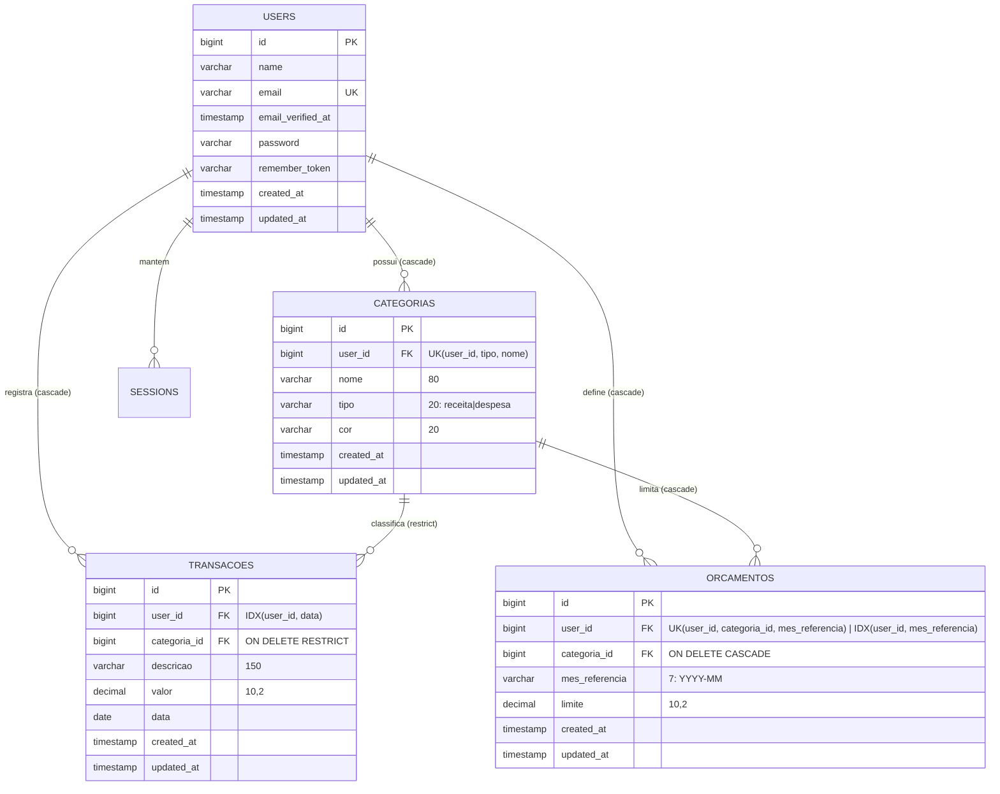

# Normalização do Banco, MER Definitivo e Conexão MySQL Specification

**Approved**: 2026-11-18 - user: "sim"

## Problem Statement

O schema atual do MeuBolso possui a coluna `tipo` duplicada em `categorias` e `transacoes`, não valida se uma meta de orçamento pertence a uma categoria de despesa, ainda está conectado ao SQLite em vez do MySQL `meubolso` recém-criado e não expõe link no menu para a tela existente de perfil (`/profile`). Normalizar o banco para a 3ª Forma Normal (3FN), alinhar regras de negócio e interface, e conectar ao MySQL garante integridade dos dados financeiros e fecha a base do projeto.

## Goals

- [ ] Eliminar a redundância `transacoes.tipo` no banco (fonte única em `categorias.tipo`) e ajustar chaves/índices no MySQL.
- [ ] Garantir consistência nos lançamentos e orçamentos (filtro dinâmico de categorias no modal de transações e metas restritas a categorias de despesa).
- [ ] Conectar o Laravel ao banco MySQL `meubolso` com schema migrado, dados de teste semeados (`danilo@meubolso.com`) e suíte de testes 100% verde.
- [ ] Tornar a tela `/profile` acessível pelo menu de navegação superior.

## Out of Scope

Explicitly excluded. Documented to prevent scope creep.

| Feature | Reason |
| ------- | ------ |
| Tela de CRUD de categorias personalizadas | Usuário optou por manter apenas as 7 categorias padrão criadas no cadastro nesta entrega |
| Novas entidades (`contas`, `cartoes`, `recorrencias`) | Fora do escopo do MVP; citadas na proposta apenas como visão futura |
| `git push` ou deploy em servidor remoto | Requer autorização explícita separada e ambiente de hospedagem |

---

## Assumptions & Open Questions

| Assumption / decision | Chosen default | Rationale | Confirmed? |
| --------------------- | -------------- | --------- | ---------- |
| Localização da coluna `tipo` | Apenas em `categorias` (removida de `transacoes`) | Garante 3FN e elimina divergência entre transação e categoria | y |
| Filtro de categoria no modal de transação | Seletor `Tipo` filtra opções de `Categoria` via JS | Evita seleção cruzada entre receita e despesa sem exigir lógica complexa | y |
| Categorias personalizadas | Manter apenas as 7 padrões em `Categoria::criarPadraoPara` | Usuário decidiu adiar tela e fluxo de criação/exclusão de categorias | y |
| Carga inicial no MySQL | `php artisan migrate --seed` com usuário demo | Usuário confirmou uso de dados de teste no banco `meubolso` | y |
| Versionamento local | `git init` local antes da execução, sem push | Permite commits atômicos por tarefa no fluxo spec-driven | y |
| Link de Perfil no menu | Link para `route('profile.edit')` na navbar | Tela já existe no projeto e não possuía navegação visível | y |
| Documentação de ambiente | Atualizar `.env.example` com placeholders MySQL | Mantém padrão de configuração documentada sem expor credenciais | y |

**Open questions:** none - all resolved or logged above.

---

## MER Alvo (Modelo Entidade-Relacionamento)

---

## User Stories

### P1: Normalização do Schema e Integridade do Tipo via Categoria ⭐ MVP

**User Story**: As a usuário do MeuBolso, I want que o tipo da transação (receita ou despesa) seja determinado exclusivamente pela categoria escolhida so that não existam dados conflitantes no banco nem distorções nos gráficos e orçamentos.

**Why P1**: Base estrutural do MER em 3FN que impacta todas as consultas de Painel, Transações, Orçamentos e Relatórios.

**Acceptance Criteria**:

1. The schema for `transacoes` SHALL omit the `tipo` column and enforce `categoria_id` as a non-null foreign key to `categorias(id)` with `ON DELETE RESTRICT`.
2. The schema for `categorias` SHALL enforce a composite unique constraint on `(user_id, tipo, nome)`.
3. The schema for `orcamentos` SHALL include an index on `(user_id, mes_referencia)` in addition to the unique constraint on `(user_id, categoria_id, mes_referencia)`.
4. WHEN an authenticated user creates or updates a transaction with a valid `categoria_id` belonging to them THEN the system SHALL persist `user_id`, `categoria_id`, `descricao`, `valor`, and `data` without storing `tipo` in `transacoes`.
5. WHEN the dashboard, transaction listing, budget calculation, or monthly report queries transactions by `receita` or `despesa` THEN the system SHALL derive the transaction type from the related `categorias.tipo` column.
6. IF an authenticated user filters `/transacoes` by `tipo=receita` or `tipo=despesa` THEN the system SHALL return only transactions whose related category has the matching `tipo`.

**Independent Test**: Executar a suíte de testes criando transações em categorias de receita e despesa e verificar cálculos do `/painel`, filtro em `/transacoes`, gastos em `/orcamentos` e geração de `/relatorios/pdf`.

---

### P1: Filtro Dinâmico no Modal de Transações e Validação de Orçamentos ⭐ MVP

**User Story**: As a usuário do MeuBolso, I want selecionar o tipo no popup de transação e ver apenas categorias compatíveis, e ter garantia de que orçamentos só sejam criados para despesas so that eu não lance dados inconsistentes.

**Why P1**: Fecha a consistência entre interface e regra de negócio após remover `transacoes.tipo`.

**Acceptance Criteria**:

1. WHILE the user has `despesa` selected in the transaction creation or edit modal THEN the system SHALL display only the user's categories with `tipo = 'despesa'` in the category selector and select a visible option.
2. WHEN the user changes the `Tipo` selector to `receita` in the transaction creation or edit modal THEN the system SHALL display only the user's categories with `tipo = 'receita'` in the category selector and select a visible option.
3. WHEN the user opens the edit modal for an existing transaction THEN the system SHALL preselect the `Tipo` matching `transacao.categoria.tipo` before selecting the transaction's `categoria_id`.
4. IF an authenticated user submits `POST /orcamentos` with a `categoria_id` whose `tipo` is not `despesa` THEN the system SHALL reject the request with validation error on `categoria_id` and SHALL NOT persist an `orcamentos` record.
5. WHEN an authenticated user deletes a budget via `DELETE /orcamentos/{orcamento}` THEN the system SHALL delete only that `orcamentos` record and SHALL preserve all records in `transacoes`.

**Independent Test**: Abrir `/transacoes` e alternar `Tipo` nos modais para confirmar troca das opções; enviar `POST /orcamentos` com categoria de receita e confirmar erro de validação; excluir uma meta e confirmar transações intactas.

---

### P1: Conexão MySQL, Carga Inicial e Verificação do Sistema ⭐ MVP

**User Story**: As a desenvolvedor/aluno apresentando o projeto, I want que a aplicação Laravel opere conectada ao banco MySQL `meubolso` com tabelas migradas e dados de teste so that todo o sistema funcione no MySQL conforme a proposta.

**Why P1**: Entrega principal pendente para sair do SQLite para o MySQL configurado na máquina.

**Acceptance Criteria**:

1. The `.env` configuration SHALL point `DB_CONNECTION` to `mysql`, `DB_HOST` to `127.0.0.1`, `DB_PORT` to `3306`, and `DB_DATABASE` to `meubolso`.
2. The `.env.example` file SHALL document the MySQL connection variables (`DB_CONNECTION=mysql`, `DB_HOST=127.0.0.1`, `DB_PORT=3306`, `DB_DATABASE=meubolso`, `DB_USERNAME=root`, `DB_PASSWORD=`) without real secrets.
3. WHEN `php artisan migrate --seed` executes against the MySQL `meubolso` database THEN the system SHALL create all tables (`users`, `categorias`, `transacoes`, `orcamentos`, `sessions`, `password_reset_tokens`, `cache`, `jobs`) and seed demo user `danilo@meubolso.com` with 7 default categories, sample transactions, and sample budgets without errors.

**Independent Test**: Rodar `php artisan migrate:fresh --seed` no MySQL `meubolso`, autenticar como `danilo@meubolso.com` e validar `/painel`, `/transacoes`, `/orcamentos` e `/relatorios/pdf`.

---

### P2: Navegação para Meu Perfil

**User Story**: As a usuário autenticado, I want acessar minha página de perfil diretamente pelo menu superior so that eu possa editar nome, e-mail, senha ou excluir minha conta sem digitar a URL.

**Why P2**: A tela `/profile` já existe no sistema, faltando apenas o link navegável no layout principal.

**Acceptance Criteria**:

1. WHILE an authenticated user views any page using `layouts/app.blade.php` THEN the navigation bar SHALL render a clickable link pointing to `route('profile.edit')`.
2. WHEN an authenticated user clicks the profile link THEN the system SHALL navigate to `/profile` with HTTP 200 and display the account, password, and delete forms.

**Independent Test**: Acessar `/painel` autenticado, verificar o link para `/profile` no HTML renderizado e segui-lo para confirmar status 200.

---

## Edge Cases

- IF an unauthenticated visitor requests `/painel`, `/transacoes`, `/orcamentos`, `/relatorios`, or `/profile` THEN the system SHALL redirect to `/login`.
- IF an authenticated user attempts to update or delete a transaction or budget owned by another user THEN the system SHALL return HTTP 403.
- IF an authenticated user attempts to create or update a transaction with a `categoria_id` owned by another user THEN the system SHALL return HTTP 404.
- IF an authenticated user submits a transaction with `valor <= 0` or missing `descricao` or invalid `data` THEN the system SHALL reject the request with validation errors and persist nothing.
- IF `orcamentos` already has a record for `(user_id, categoria_id, mes_referencia)` and the user submits a new `limite` for the same key THEN the system SHALL update the existing `limite` without creating a duplicate row.

---

## Implicit-Requirement Dimensions Sweep (Medium Scope)

- **Input validation & bounds:** Valores monetários (`valor`, `limite`) exigem `numeric|min:0.01`; `descricao` limitada a 150 caracteres; `mes_referencia` restrito ao regex `^\d{4}-\d{2}$`; `categoria_id` validado por posse do usuário e `tipo === 'despesa'` nos orçamentos.
- **Auth boundaries:** Todas as rotas de domínio exigem middleware `auth` e verificação explícita de `user_id` (`abort_if(... !== auth()->id(), 403)` ou escopo `$user->...()->findOrFail()`).
- **Data lifecycle / referential integrity:** `transacoes.categoria_id` mantém `ON DELETE RESTRICT`; `orcamentos` mantém `ON DELETE CASCADE` a partir de `categorias` e `users`, sem apagar transações quando uma meta é removida.
- **Remaining dimensions (external calls, rate limits, concurrency, observability):** N/A because this is a single-tenant-per-user academic CRUD web app with local MySQL and no external API integrations or async queues.

---

## Requirement Traceability

| Requirement ID | Story | Phase | Status |
| -------------- | ----- | ----- | ------ |
| DB-01 | P1: Normalização do Schema e Integridade do Tipo via Categoria | Tasks | Verified |
| DB-02 | P1: Normalização do Schema e Integridade do Tipo via Categoria | Tasks | Verified |
| DB-03 | P1: Normalização do Schema e Integridade do Tipo via Categoria | Tasks | Verified |
| TRX-01 | P1: Normalização do Schema e Integridade do Tipo via Categoria | Tasks | Verified |
| TRX-02 | P1: Normalização do Schema e Integridade do Tipo via Categoria | Tasks | Verified |
| TRX-03 | P1: Normalização do Schema e Integridade do Tipo via Categoria | Tasks | Verified |
| UI-01 | P1: Filtro Dinâmico no Modal de Transações e Validação de Orçamentos | Tasks | Verified |
| ORC-01 | P1: Filtro Dinâmico no Modal de Transações e Validação de Orçamentos | Tasks | Verified |
| ORC-02 | P1: Filtro Dinâmico no Modal de Transações e Validação de Orçamentos | Tasks | Verified |
| ENV-01 | P1: Conexão MySQL, Carga Inicial e Verificação do Sistema | Tasks | Implementing |
| ENV-02 | P1: Conexão MySQL, Carga Inicial e Verificação do Sistema | Tasks | Pending |
| NAV-01 | P2: Navegação para Meu Perfil | Tasks | Verified |

**Coverage:** 12 total, 0 mapped to tasks, 12 unmapped

---

## Sources

- `C:\Users\danil\Downloads\PROPOSTA_MeuBolso.docx` - Escopo acadêmico do MeuBolso (Laravel, MySQL, autenticação, lançamentos, metas, dashboard e PDF)
- `AGENTS.md` - Convenções MVC clássicas de 4º período e pendências do ambiente MySQL

---

## Success Criteria

- [ ] Nenhuma coluna redundante `tipo` existe na tabela `transacoes` e o MER está aderente à 3FN.
- [ ] Todos os testes automatizados (`php artisan test`) passam após todas as alterações, incluindo novos testes de integridade de orçamento, derivação de tipo e navegação de perfil.
- [ ] Banco MySQL `meubolso` migrado e semeado com sucesso via `php artisan migrate --seed`, validado via requisições reais contra MySQL.
