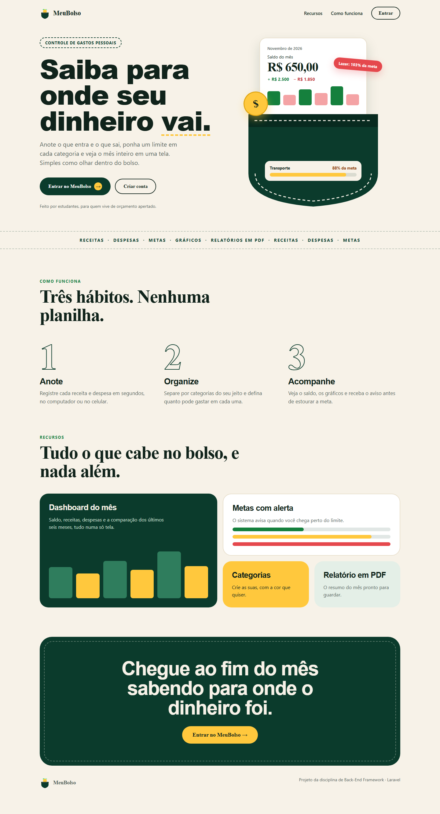

# Tela de Apresentação Specification

**Approved**: 2026-11-18 - user: "pode"

## Problem Statement

Atualmente a rota raiz `/` do MeuBolso redireciona imediatamente para `/painel` (que envia visitantes para `/login`), sem oferecer uma página pública de apresentação antes da entrada no sistema. Precisamos criar a tela de apresentação na rota `/` seguindo fielmente o layout enviado pelo usuário e conectando seus botões às rotas reais de entrada e cadastro.

## Goals

- [ ] Servir a tela de apresentação na rota `/` (`GET /`) com HTTP 200 tanto para visitantes quanto para usuários autenticados.
- [ ] Reproduzir fielmente a composição, tipografia, cores, ilustrações SVG, seções e responsividade da captura vinculante `.specs/features/tela-apresentacao/captures/apresentacao-desktop.png`, aplicando a diferença aprovada em `AD-002`.
- [ ] Conectar os links de navegação (`#como-funciona`, `#recursos`), entrada (`/login`) e cadastro (`/cadastro`) às rotas reais da aplicação Laravel, sem `npm`, Vite ou Tailwind.

## Out of Scope

Explicitly excluded. Documented to prevent scope creep.

| Feature | Reason |
| ------- | ------ |
| CRUD de categorias personalizadas | Sistema atual usa 7 categorias padrão; o card "Categorias" será ajustado para refletir o comportamento atual (`AD-002`) |
| Alterações nas telas de Login, Cadastro ou Painel | Usuário escolheu manter as telas de autenticação sem mudanças |
| Exibição de dados reais do banco na ilustração da landing | A ilustração do hero exibe valores de exemplo estáticos conforme o design enviado |
| Build pipeline com Vite, npm ou Tailwind | Regra do projeto exige 100% Blade + CSS estático em `public/` |

---

## Assumptions & Open Questions

Every ambiguity is resolved or recorded here - nothing is left silently unclear.

| Assumption / decision | Chosen default | Rationale | Confirmed? |
| --------------------- | -------------- | --------- | ---------- |
| Comportamento de `GET /` para usuários autenticados | Renderizar a mesma tela de apresentação para todos, com links para `/login` e `/cadastro` | Usuário escolheu esta opção explicitamente; middleware `guest` já redireciona logados ao acessar `/login` ou `/cadastro` | y |
| Destino dos links e botões da tela | `Recursos` → `#recursos`, `Como funciona` → `#como-funciona`, `Entrar` / `Entrar no MeuBolso →` → `/login`, `Criar conta` → `/cadastro` | Usuário confirmou a ligação padrão sem alterar as views de auth | y |
| Texto do card `Categorias` no bento grid | `"Categorias prontas e coloridas para receitas e despesas."` | Usuário escolheu ajustar o texto para refletir as 7 categorias padrão atuais (`AD-002`) | y |
| Organização de CSS e view | View `resources/views/apresentacao.blade.php` com CSS isolado em `public/css/apresentacao.css` (sem conflito com `meubolso.css` ou Bootstrap) | Mantém padrão Laravel clássico sem `npm`/Vite/Tailwind e isola estilos da landing do painel interno | y |
| Largura de verificação em navegador | Captura desktop em `1440px` de largura (com suporte responsivo CSS para mobile `<= 900px` / `<= 700px` mantido do HTML fonte) | Captura vinculante foi gerada em `1440px` a partir do HTML fornecido | y |

**Open questions:** none - all resolved or logged above.

---

## User Stories

### P1: Exibir Tela de Apresentação na Rota Inicial ⭐ MVP

**User Story**: As a visitante do MeuBolso, I want visualizar a página de apresentação ao acessar `/` so that eu entenda o sistema e possa clicar para entrar ou criar minha conta.

**Why P1**: Entrega a porta de entrada completa do sistema na rota raiz `/`.

**Acceptance Criteria**:

1. WHEN any visitor or authenticated user sends `GET /` THEN the system SHALL return HTTP 200 and render the presentation page shown in `.specs/features/tela-apresentacao/captures/apresentacao-desktop.png` (applying the approved text change in `## Differences from the source`).
2. The presentation page SHALL include the navigation anchors `#como-funciona` and `#recursos` linking to the "Como funciona" and "Recursos" sections on the page.
3. WHEN a visitor clicks "Entrar" in the top bar, "Entrar no MeuBolso →" in the hero, or "Entrar no MeuBolso →" in the bottom CTA THEN the browser SHALL navigate to `route('login')` (`/login`).
4. WHEN a visitor clicks "Criar conta" in the hero THEN the browser SHALL navigate to `route('cadastro')` (`/cadastro`).
5. The system SHALL preserve the existing redirect from `GET /login` and `GET /cadastro` to `/painel` for authenticated users and the existing logout redirect to `/` (`GET /`).

**Independent Test**: Acessar `GET /` como visitante e como usuário autenticado, verificar status 200, presença das seções/textos esperados e URLs de destino (`/login`, `/cadastro`, `#como-funciona`, `#recursos`), e executar `php artisan test`.

---

## Edge Cases

- IF a user logs out via `POST /logout` THEN the system SHALL redirect to `/` (`GET /`), displaying the presentation page with HTTP 200 instead of bouncing back to `/login`.
- IF an authenticated user clicks `/login` or `/cadastro` from the presentation page THEN Laravel's `guest` middleware SHALL redirect them to `/painel` without errors.
- IF the presentation page is opened on narrow viewports (`<= 900px` and `<= 700px`) THEN the CSS responsive rules from the source HTML SHALL stack the hero, bento grid, and header links without horizontal overflow.

---

## Implicit-Requirement Dimensions Sweep (Medium Scope)

- **Auth boundaries:** `GET /` é rota pública (sem middleware `auth` ou `guest`), enquanto `/painel`, `/transacoes`, `/orcamentos`, `/relatorios` e `/profile` permanecem protegidos por `auth`.
- **Remaining dimensions (input validation, failure states, idempotency, concurrency, data lifecycle, observability, external dependencies, state transitions):** N/A because this feature serves a static Blade presentation page without form submission, database writes, or external API calls.

---

## Requirement Traceability

| Requirement ID | Story | Phase | Status |
| -------------- | ----- | ----- | ------ |
| LAND-01 | P1: Exibir Tela de Apresentação na Rota Inicial | Execute | Pending |
| LAND-02 | P1: Exibir Tela de Apresentação na Rota Inicial | Execute | Pending |
| LAND-03 | P1: Exibir Tela de Apresentação na Rota Inicial | Execute | Pending |
| LAND-04 | P1: Exibir Tela de Apresentação na Rota Inicial | Execute | Pending |
| LAND-05 | P1: Exibir Tela de Apresentação na Rota Inicial | Execute | Pending |

**Coverage:** 5 total, 5 mapped to tasks, 0 unmapped

---

## Differences from the source

| Source shows | Product shows | Confirmed |
| ------------ | ------------- | --------- |
| Card `Categorias`: `"Crie as suas, com a cor que quiser."` | Card `Categorias`: `"Categorias prontas e coloridas para receitas e despesas."` | y - AD-002 |

## Sources

- Solicitação do usuário no chat + arquivo `C:\Users\danil\Downloads\MeuBolso – Tela de apresentação.html`.
-  - binding - Tela completa de apresentação do MeuBolso (topo, hero com ilustração de bolso e metas, faixa de recursos, seção Como funciona, bento grid de Recursos, CTA final e rodapé).

---

## Success Criteria

- [ ] Acessar `http://127.0.0.1:8000/` exibe a tela de apresentação com layout fiel à captura vinculante e texto atualizado do card `Categorias` (`AD-002`).
- [ ] Todos os botões e links (`#como-funciona`, `#recursos`, `/login`, `/cadastro`) navegam para os destinos corretos.
- [ ] Toda a suíte `php artisan test` passa após as alterações (atualizando o antigo `ExampleTest` que esperava redirecionamento de `/` para `/painel`).
